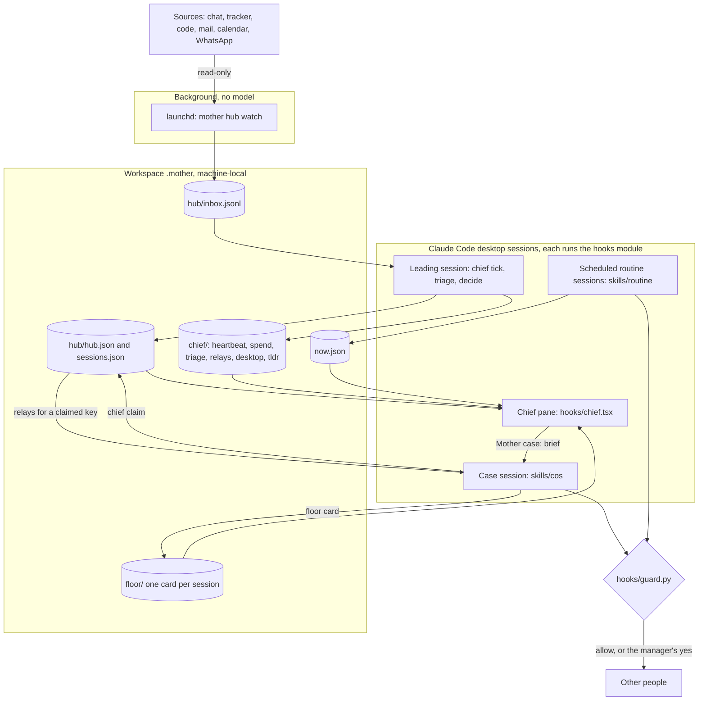
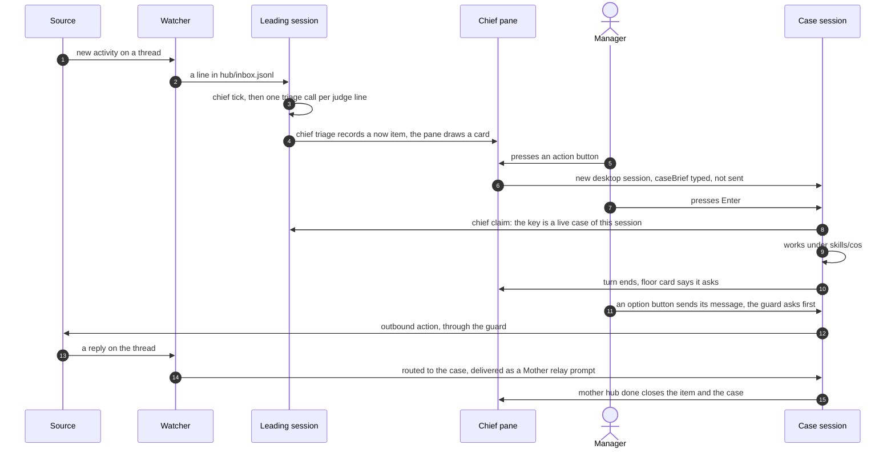

# Architecture

A map of the code, for whoever changes it next. *Why* lives in [docs/DESIGN.md](docs/DESIGN.md); the exact
rules (file formats, config keys, guard decisions) live in [docs/CONTRACT.md](docs/CONTRACT.md). This page
says where things are and how they connect.

## The big idea

MOTHER is a Claude Code **plugin**. Most of its behaviour is Markdown the model follows (skills, routines,
rules). The parts that must hold even when the model forgets, gets confused or reads a hostile email are
**Python**, and they run outside the model's control: a hook that judges every outbound call, a CLI that owns
state and git, and small engines whose JSON answers the skills must use.

```
            plugin repo (shared, versioned)                    workspace (one per manager, private)
 ┌─────────────────────────────────────────────┐      ┌──────────────────────────────────────────┐
 │ Markdown the model follows                  │      │ config.json        who, teams, routines  │
 │   skills/   routines/   rules/   agents/    │ ───▶ │ capabilities.json  per-server health     │
 │                                             │reads │ memory/ todos/ people/ teams/ projects/  │
 │ Python that holds regardless                │writes│ journal/ one-on-ones/  runs.md           │
 │   hooks/guard.py  bin/mother  lib/*.py      │      │ .mother/  machine-local state (gitignored)│
 └─────────────────────────────────────────────┘      └──────────────────────────────────────────┘
```

Plugin = code, workspace = data. The plugin never stores anything about a manager; the workspace never
holds code a later session would run.

## Processes and files

One background process (the watcher, no model). Everything that calls a model is a Claude Code session the
manager can see. There is no long-lived chief session, no pool of headless workers and no decision batch: those
were removed in 0.18.0, and nothing should bring them back (see AGENTS.md, "What not to do"). Two opt-in
features still start a short headless `claude -p` run and are unchanged: the channel reply loop's read-only
answer session (`lib/channels.py`) and the A/B harness (`lib/evals.py`).



## Code map

| Path | What it is | Notes |
|---|---|---|
| `.claude-plugin/` | Plugin manifest and marketplace entry | Version lives here and in `bin/mother` |
| `hooks/hooks.json` | Wires the hooks | `modules` → `hooks/register.tsx` (the one hooks module); PreToolUse → `hooks/guard.py` for the tools it has rules for and `hooks/guard_fast.py` for every other tool (`tests/test_packaging.py` checks each tool reaches exactly one); Stop and SessionEnd → `mother sync --quiet`. The command hooks run even if the module fails to load |
| `hooks/register.tsx`, `types/index.d.ts` | The hooks module's entry (mod API, early access) and the Now panel: `/now-panel` opens Home, a row opens the Inspector pane, status line, toasts. Owns the module's one `session.start` hook and the one-minute timer, and calls `registerChief` | Reads `.mother/now.json` and the hub's files; writes only through `mother now …` / `mother hub …`. `mother_bin` userConfig, empty = `${plugin root}/bin/mother`. Tests: `claude plugin test .` (`hooks/register.test.tsx`) |
| `hooks/chief.tsx` | The Chief pane (`/chief`) and the leading session's pass: `chiefPass` (snapshot pinned sessions, `tick --as`, triage, relay, floor reload, TL;DRs), the Inbox, Sessions, Needs you and Today sections, the `/chief` verbs | Every write is a `mother chief …` or `mother hub …` verb. Model calls: triage (`TRIAGE_SYSTEM`) and TL;DRs (`TLDR_SYSTEM`), both counted in the daily budget. Tests: `hooks/chief.test.tsx` |
| `hooks/pane_ui.tsx` | The pane's drawing kit: header strip and banner, tab row, card frame, badges, action buttons, the source colour map, the verdict's shape (`kind`, `on`, `urgency`, `actions`) | Pure: reads no state, runs no action |
| `hooks/pane_tabs.tsx` | The Team and Health tabs, the Suggested cards on Today, Follow / Ignore on an Inbox card | Handed what `hooks/chief.tsx` read; never reads a file itself |
| `hooks/cos.ts` | Cases: the `Mother case:` brief, the claim on a session's first prompt, the relay (`Mother relay:`) with its bounds | Contract for the session itself: `skills/cos/SKILL.md`. CONTRACT §5g "Cases" |
| `hooks/floor.ts` | The floor: when a pinned or case session's turn ends, one model call says whether it stopped on a question; the card feeds Needs you | Writes through `mother floor card`. CONTRACT §5g "The floor" |
| `hooks/shared.ts` | Helpers both panes use: the `mother` binary path, text cleaning (`safe`, `oneLine`), ages, the prompt-fill helpers | |
| `hooks/guard.py` | **Approval guard**: allow / ask / deny for every outbound call; `.mother/GUARD_OFF` (`mother guard off`) turns every rule off, `.mother/PAUSED` denies everything outbound and wins | Recognises tools by capability, not server name. Fails closed. |
| `hooks/guard_fast.py` | The fast path for tools the guard has no every-session rule for (Read, Grep, Glob, …): hands the call to `hooks/guard.py` only for sub-agents, channel sessions, hub and hub-fed sessions | Never decides by itself. CONTRACT §5 |
| `bin/mother` | The CLI: workspace lifecycle, sync, scan, home machine, status, `guard off\|on\|status`, register, runs watchdog, speak/tts | Dispatches `channels`, `whatsapp`, `hub`, `chief`, `floor`, `inbox`, `grant`, `items`, `now`, `eval`, `health` to `lib/`. `VERSION` lives here and in `.claude-plugin/plugin.json` |
| `lib/health.py` | Per-server connector health (`mother health`): record, pick a server, classify an error, merge the doctor's result, once-a-day alerts | **The only writer of `capabilities.json`** (file lock, atomic write); appends `health.md`. CONTRACT §4 |
| `lib/channels.py` | Reply-mode engine behind `mother:channels` | The skill does chat I/O; this decides who, when, and what. CONTRACT §5b |
| `lib/whatsapp.py` | `mother whatsapp`: chats and read from the local WhatsApp database, send through the bridge, setup and link | Home machine only; the guard asks before each send to someone else. CONTRACT §5d |
| `bridge/whatsapp/` | Send-only WhatsApp bridge (Node, Baileys linked device) on a 0600 Unix socket | Optional; `checks.mjs` = pure send rules (cap, gap), `bridge.mjs` = socket + WhatsApp. CONTRACT §5d |
| `lib/grants.py` | `mother grant add\|remove\|list`: the one writer of `.mother/grants.json` for unattended runs | Checks each grant with the guard's own `valid_grant` before writing; the guard asks for any other write. CONTRACT §5 |
| `lib/floor.py` | `mother floor card\|list`: one card per session in `.mother/floor/` | Each pinned or case session's own copy of the module (`hooks/floor.ts`) writes whether its last turn stopped on a question for the manager; the Chief pane draws them as Needs you (CONTRACT §5g). |
| `lib/items.py` | Evidence check on a reader sub-agent's reply | Drops uncited items; bad output = `couldnt_check`. CONTRACT §5c |
| `lib/now.py` | Deterministic core of the hourly tick and Now panel (working hours, signal thresholds, merge into `now.json`, the `mother now` verbs) | Python 3.9 stdlib only |
| `lib/hub.py` | State core of the watcher and hub: thing keys, inbox lines, `.mother/hub/` files (atomic, locked) | Python 3.9 stdlib only |
| `lib/hub_mcp.py` | Minimal MCP stdio client plus the read-only wrapper the watcher uses | Allow-list enforced before send. CONTRACT §5e |
| `lib/inbox.py` | `mother inbox archive\|read`: the Now panel's mail triage over the hub's mail connection, no model | Asks `guard.classify_mcp` before each write, stops while PAUSED, logs to guard.log; the triage tools live in `hub_sources.MailGmail.TRIAGE`. CONTRACT §5f |
| `lib/hub_sources.py` | Per-capability poll adapters and the deterministic prefilter | Product-specific tool names live only here. The `whatsapp` adapter reads through `LocalWhatsApp` (the reader functions of `lib/whatsapp.py` only: no bridge, no send). CONTRACT §5e |
| `lib/chief.py` | `mother chief tick\|triage\|lines\|context\|status\|pinned\|tail\|tldr\|spend\|portrait\|report\|claim\|relays\|relay\|pause\|resume`: the leading desktop session's pass (heartbeat and leader rule, muted lines logged, judge lines decided in code from a triage model's verdicts), the names-only triage context, the pane's status, pinned sessions, TL;DRs, the daily model spend, case claims and the relay queue, all under `.mother/chief/` | The model never writes a decision: `triage --stdin --decide` does. What the layer removed in 0.18.0 left on disk is ignored. CONTRACT §5g |
| `lib/evals.py` | Blind A/B harness for a routine change (`mother eval`) | Both runs dry (`MOTHER_DRY_RUN=1`) |
| `lib/tts_kokoro.py` | Optional neural voice for the spoken brief | Runs in its own venv under `~/.mother/tts` |
| `skills/<name>/SKILL.md` | What the model does for a request, invoked as `mother:<name>` | `templates/` beside a skill = files it creates in the workspace |
| `routines/<id>.md` | What one scheduled run does | Frontmatter: `id`, `needs`, `writes`, `sends`, `config`, `default` |
| `agents/` | Read-only sub-agents: `reader` (one source → cited JSON), `critic` (draft → PASS/FIX) | Read-only is enforced by the guard, not the frontmatter alone |
| `rules/` | Policy text the skills cite: outbound, privacy, memory, todos, projects, teams | When `outbound.md` and the guard disagree, the guard wins |
| `assets/deck/`, `assets/plan/` | Self-contained HTML templates + `build.py` (JSON in → HTML out) | Meeting deck with meeting mode; sprint plan page |
| `assets/art/` | The bundled portrait the Chief pane's header draws (`mother chief portrait`) | A workspace's own `.mother/portrait.png` replaces it |
| `templates/workspace/` | Skeleton `mother init` copies into a new workspace | Includes the **persona** `AGENTS.md` for the manager's agent |
| `tests/` | stdlib `unittest`, one module per Python component plus packaging and docs | `test_packaging` checks every runtime file is tracked and every tool reaches the guard; `test_docs` checks this page and AGENTS.md |
| `docs/` | CONTRACT (spec), DESIGN (why), ROADMAP (stages), GUIDE (how to operate it), `docs/assets/` (the README's mock images) | `docs/drafts/`, `docs/superpowers/` are untracked personal notes |

Skills: `setup`, `doctor`, `routine` (the dispatcher), `brief`, `now`, `hub`, `digest`, `dots`, `commitments`,
`one-on-one`, `meeting`, `channels`, `reflect`, `todo`, `project`, `team`, `remember`, `whatsapp`, `cos`.

Routines: `brief` (+ `brief-ab`), `digest`, `dots`, `tick`, `commitments`, `one-on-one`, `meeting-prep`,
`meeting-recap`, `reflect`, `doctor`, `weekly-snapshot`, `monthly-refresh`.

## How a scheduled run flows

```
Claude Code scheduler (desktop app, home machine only, local-time cron from `mother register`)
  └─ thin pointer prompt: cd <workspace>; git pull --rebase; run mother:routine with id <id>
      └─ skills/routine  ── mother home check · stop on .mother/PAUSED · mother status · day check
          ├─ pre-flight (~60 s, never fatal): send `mother health pending` alerts; for each `needs`
          │     capability `mother health pick` → probe a stale read, heal (reconnect, backup server),
          │     record and alert once a day; writes are never probed. Unhealed = "couldn't check", `partial`
          └─ routines/<id>.md  ── step list, calling skills (mother:brief, mother:todo, …)
              ├─ gather: connectors directly, or one mother:reader per source → `mother items check`
              │     a call that fails mid-run: `health classify` + `record`, `pick` again, retry once there
              ├─ judge and write: workspace files (journal/, todos/, teams/…)
              ├─ check: mother:critic on any draft another person will see
              ├─ send: MCP / gh call ──▶ hooks/guard.py decides allow · ask · deny, logs to .mother/guard.log
              └─ one line in runs.md
  └─ Stop hook: mother sync → secret scan → commit → pull --rebase → push
```

An interactive request ("brief me") enters at the skill and skips the dispatcher.

The daily `doctor` routine runs before the first routine of the day: it re-tests every connector read-only,
heals what it can without a human (re-test, reconnect, switch server), merges the result through
`mother health merge`, and alerts the manager once per broken connector. Sign-ins and write checks happen
only in an interactive `/mother:doctor`.

## How a channel reply flows

```
/loop /mother:channels   (a Claude session, cheap model)
  ├─ mother channels plan          → what to poll
  ├─ skill reads chat              → mother channels triage (stdin JSON) → actions
  ├─ mother channels run --action  → headless `claude -p` with MOTHER_CHANNEL_ROLE=manager|team|anyone
  │                                   the guard narrows that session: no outbound, limited reads
  ├─ answer → guard grant written; skill posts the signed reply │ draft → manager's DM │ skip
  └─ mother channels done          → state in .mother/channels.json, audit in .mother/channels.log
```

## How the inbox flows

```
launchd: mother hub watch   (lib/hub.py + hub_mcp.py + hub_sources.py, no model, read-only allow-list)
  ├─ per connection: read-only MCP over stdio (or `gh`, or the local WhatsApp database) → adapter → deterministic prefilter
  ├─ chat also reads the DMs mapped in watch.json follow.dms (`mother hub dms set`) and the self-DM inbox (follow.inbox → `manual` lines)
  ├─ appends one line per changed thing to .mother/hub/inbox.jsonl; heartbeat in watcher.json
  └─ records nothing in capabilities.json: watcher.json plus one inbox `error` line are the record

every desktop session: hooks/register.tsx timer → chiefPass (hooks/chief.tsx), once a minute
  ├─ mother chief pinned --stdin        snapshot the app's pinned sessions (list_sessions, no model turn)
  ├─ mother chief tick --json --as <session id>
  │     leader rule: a fresh heartbeat (120 s) from another session → {"skipped": …}, nothing else runs
  │     the leader: muted lines logged in code; the rest come back as `judge` (at most 20)
  ├─ triage (leader only): mother chief lines --json → one model call per line (chief.triage_model), in parallel
  │     prompt = fixed note + {context, line} as JSON; context = `mother chief context --json` (names only)
  │     verdict = {is_work, needs_attention, kind, on, urgency, title, tldr, actions[2-3]}, parsed strictly
  ├─ mother chief triage --stdin --decide   code records `log` or `now` per line; no verdict = `now`, never `log`
  │     a `now` whose key has a live session is stored as a route to it
  ├─ relay: a session holding a live case with waiting lines submits ONE `Mother relay:` prompt into itself
  ├─ mother floor list --json          every session's card, for Needs you
  └─ TL;DRs for pinned sessions, only while the pane is shown (mother chief tail → model → mother chief tldr)
```

A terminal session runs the same module but never ticks: it only reads. `/mother:hub` (`skills/hub/SKILL.md`)
is the older, model-driven way to decide the inbox from one session; it refuses to start while a desktop session
leads, and it shares the same files and `mother hub decide`.

Accepted gaps (also in CONTRACT §5e):

- The tracker adapter misses edits to fields other than status, assignee, priority and comments (labels, summary, description). It reads the changelog to tell the manager's own status, assignee and priority edits from anyone else's: a line resolves only when every such change since the cursor is the manager's, and a changelog it cannot read leaves an update (a comment by the manager does resolve).
- An unthreaded reply in a watched channel does not resolve the message it answers; only a reply in the thread (or in a DM) does.

## The Chief pane

`/chief` opens pane `mother-chief`. A draw is pure: `ui.render` reads atoms and returns elements; state changes
happen on the timer pass, a button press or a command, never in a draw.

| Tab | Holds | Drawn by |
|---|---|---|
| Needs you | Sessions on the floor whose card asks: the question, one button per option, Open | `hooks/chief.tsx` (cards from `hooks/floor.ts`) |
| Inbox | The hub's open `now` items by urgency then age, at most 10; watcher errors are Health's | `hooks/chief.tsx` `inboxSection` |
| Sessions | Pinned desktop sessions (asking, active, idle), then case sessions that are not pinned | `hooks/chief.tsx` |
| Today | Suggested, the tick's Top 3, the on-you items of `now.json` | `hooks/chief.tsx`, `hooks/pane_tabs.tsx` |
| Team | The tick's neglected items, a group per team | `hooks/pane_tabs.tsx` |
| Health | Sources, the watcher's last poll, watcher errors, undelivered routine reports, budget and lead, guard | `hooks/pane_tabs.tsx` |
| All | Every section stacked | |

A card is two rows closed (title with up to three action buttons, the first primary; then badges, a human
label, age, source link) and everything when open. An Inbox card's actions are the verdict's, else two fixed
suggestions per source. All model- or line-written text is cleaned (`safe`, `oneLine`) and drawn as plain text.

## Cases, relay and the floor

The life of one item, from a source to done:



- **Brief and claim** (`hooks/cos.ts`). `caseBrief` writes `Mother case: <title>`, `Key:`, `Source:`, why, the
  instruction to use `mother:cos`, and the closing command. The first prompt of a session that starts with it
  runs `mother chief claim --stdin`; the key's row in `.mother/hub/sessions.json` becomes a live case.
- **Relay.** `hub.decide` stores a `now` for a claimed key as a route. `mother chief relays --for <id>` lists
  what waits; the session submits it as one prompt and only then acknowledges (`--ack`), so a failed submit
  loses nothing. At most one attempt per 5 minutes and 6 an hour; `.mother/chief/RELAY_OFF` holds it back.
- **Floor** (`hooks/floor.ts`, `lib/floor.py`). When a main-loop turn of a pinned or case session ends on an
  answer, one model call over the last 3000 characters of its final message decides `asks`, the question and up
  to four options. A prompt submitted in that session clears its card with no model call.
- **A case session is hub-fed** for the guard: its id is in `sessions.json`, so functional autonomy is off there
  and outbound actions ask.

## Invariants the code relies on

- **Visible work only.** Model work happens in sessions the manager can open. The one background process
  (the watcher) has no model.
- **Code records decisions.** A triage model's verdict is data; `mother chief triage --decide` decides, and a
  missing or off-shape verdict keeps the line in front of the manager.
- **One writer.** Only MOTHER (the routine or interactive session) judges, writes and posts. Sub-agents and
  channel sessions read and hand back data; their output approves nothing.
- **Capabilities before claims.** A routine checks each capability it needs before using it. A source it
  couldn't reach is reported as "couldn't check", never as quiet.
- **One writer for connector state.** Only `mother health` writes `capabilities.json` and `health.md`.
  Skills and routines call it; they never edit the file. The server order in `servers.<cap>` is a
  preference that a failure never reorders, so a recovered server is used again.
- **Evidence or silence.** Anything shown to the manager cites a link; `lib/items.py` enforces this for
  readers.
- **Fail closed.** No workspace, a bad config or a crash in the guard means *ask*, never *allow*. The guard
  never answers *allow* for a call it doesn't recognise.
- **Tighten only.** Workspace policy and personal rules may narrow the plugin's defaults, never widen them.
- **Machine-local vs synced.** `.mother/` (grants, ledger, guard log, channel state, hub, chief and floor files, audio, eval pairs) is
  gitignored and per machine; everything else in the workspace syncs.

## Finding things

- The workspace path: `$MOTHER_WORKSPACE`, else `$MOTHER_STATE_DIR/workspace` (default `~/.mother/workspace`).
- Plugin files from a skill: `${CLAUDE_PLUGIN_ROOT}/…`. Routines never hard-code a path.
- Environment switches: `MOTHER_DRY_RUN` (guard denies all outbound), `MOTHER_NO_SYNC` (sync is a no-op),
  `MOTHER_CHANNEL_ROLE` / `MOTHER_CHANNEL_SERVERS` (channel session limits); for tests, `MOTHER_HOSTNAME`
  (this machine's name), `MOTHER_NOW` (a fixed clock for `runs` and `health`) and `MOTHER_SAY_BIN` (the
  speech binary).
