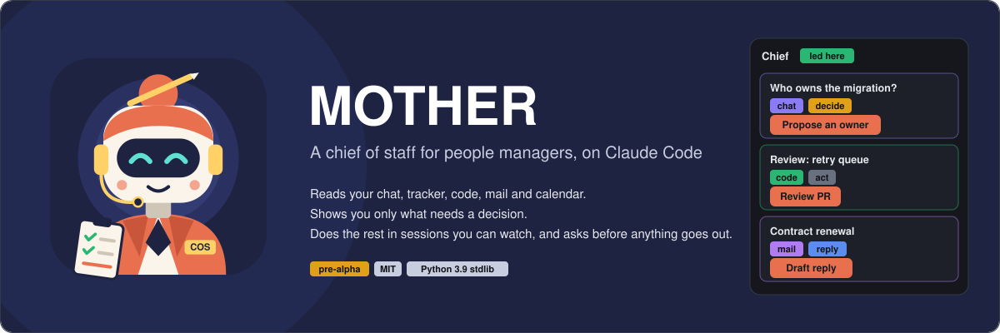
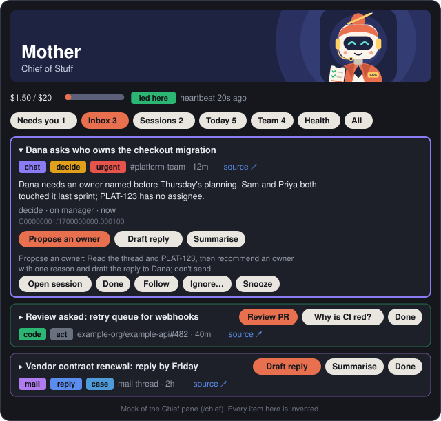
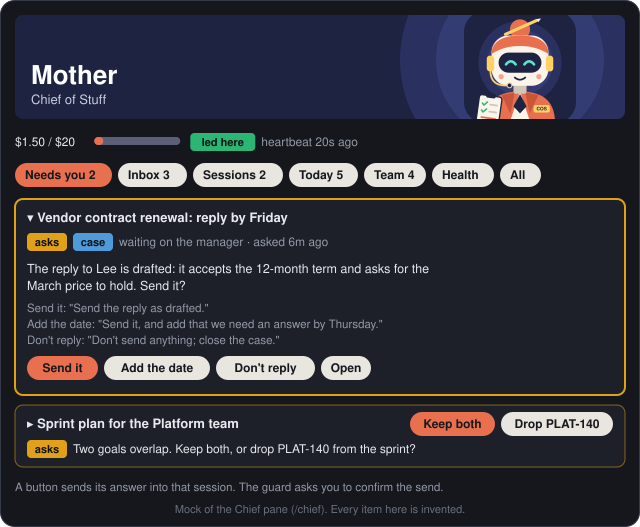
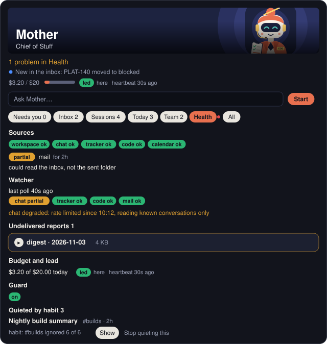
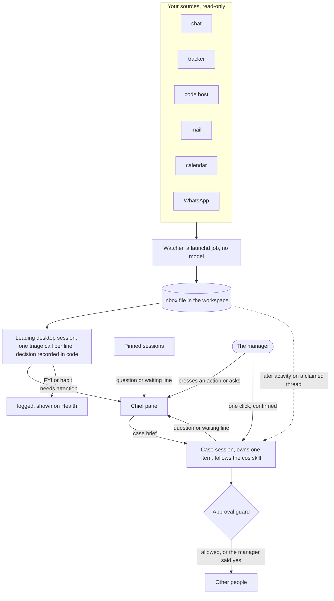

# MOTHER

**M**anager's **O**perations, **T**asks, **H**andoffs, **E**xecution & **R**eporting.

A chief of staff for people managers, built as a [Claude Code](https://claude.com/claude-code) plugin.
It reads your chat, tracker, code host, mail and calendar, shows you only what needs a decision, and does the
rest in sessions you can watch. Anything another person would see waits for your yes.



> **Status: pre-alpha, one pilot.** One manager's workspace has run on it since 2026-10-23; nobody else has
> yet. The Chief pane and the Now panel use Claude Code's hooks-module API, which is early access. Expect rough
> edges, and please report them.

> Yes, it's named after the ship's computer in *Alien*. Unlike that one, this Mother never treats the crew as
> expendable: it works for the manager, in the open, and anything another person sees carries its signature.

**Contents:** [A day with it](#a-day-with-it) · [The Chief pane](#the-chief-pane) · [How it works](#how-it-works) ·
[Install and first run](#install-and-first-run) · [Skills](#skills) · [Routines](#routines) · [Safety](#safety) ·
[Configuration](#configuration) · [FAQ](#faq) · [Development](#development)

## A day with it

Sam manages two teams. Sam's agent is called Agnes, and signs what it writes `✨ Agnes (AI) · on behalf of Sam`.

1. **08:45, the brief.** A message lands in Sam's own DM: today's calendar, the mail and chat that need an
   answer, the review queue, overdue open loops, and a numbered list Sam hands back with "go 1 3".
2. **09:00, the digest.** One post per team, opening with a short decision queue. Sam answers in the thread:
   "12 ticket, 13 drop, 14 mine".
3. **10:20, an Inbox card.** Dana asks in a team channel who owns a migration. A desktop notification says so, the
   pane's top line reads `Urgent: who owns the migration?`, and a card waits with `decide` and `urgent` badges. Sam
   presses its one coral pill, **Propose an owner**. A new session opens with a brief already typed; Sam reads it and
   presses Enter.
4. **10:26, one question.** That session read the thread and the ticket, drafted a reply, and ended its turn with a
   question. **Needs you** shows it: why it needs Sam, a coral pill on the recommended answer, **Hold**, and a field to
   say something else. Sam presses **Send it**, confirms at the guard, and the reply goes out, signed.
5. **11:30, the Ask box.** Sam types `how is the billing session`: the answer appears under the box, read from that
   session's card. `tell billing to rebase first` goes straight to it. `tell billing to merge` stops on **Send
   anyway?**, because `merge` is a risky word. `find out why signups dropped` opens a new case.
6. **14:00, a follow-up.** Dana answers in the thread. No new card appears: the reply is relayed into the session
   that owns the case, framed as other people's words. It marks the item done and reports in three lines.
7. **16:10, a sign-in card.** The tracker's token expired. Needs you opens with `Sign-in needed: tracker` and a
   **Retry**. Sam signs in, presses it, and the card goes.
8. **Thursday, a chase and a Done.** A pinned session has said `Waiting on: Dana — the signed scope` for three days:
   a card offers **Draft a nudge**, **Keep waiting** and **Drop it**. Another said `Waiting on: nothing — done` and has
   been quiet ten minutes: **Archive** clears it, with a 10-second **Undo**.

At 21:30 a nightly pass turns the day into memory and sweeps the open loops, so tomorrow's brief knows what
today decided. Over the weeks the pane learns too: a channel Sam ignored every time stops making cards, and Health
says what was quieted and why.

## The Chief pane

`/chief` opens a pane beside the chat (Claude Code desktop app). The images below are mocks with invented items.

| Inbox | Needs you |
|---|---|
|  |  |

- **Header.** A banner or portrait (your own `<workspace>/.mother/portrait.jpg`, or the bundled one). Under it one
  sentence on how things stand (the mood line, from the counts, no model call), then a dim line saying what just
  changed, then today's spend against the budget, who leads, the heartbeat's age, and a red pill while the guard is
  off or paused.
- **Ask box.** `Ask Mother…` with **Start**. A few commands are read in code (`tell <session> …`, `status of <session>`,
  `hide`, `show`, `open`, `pause`, `resume`, `why <key>`). Anything else is one model call over the floor, which
  answers, tells a session, reports on one, or opens a case. The answer says which route it took. A message with a
  risky word or an outside link waits on **Send anyway?**.
- **Cards.** Three rows: a small caret and the title; badges, a human label, age and a source link; then the pills.
  Exactly one pill is coral, the recommended action; the rest are cream. Click the caret to expand: the whole
  reason, every labelled link, what each button would send, and the rest of the actions.

| Tab | What it holds | Its buttons |
|---|---|---|
| **Needs you** | Sign-in and network problems; questions from your sessions; waits to chase; finished sessions | Retry, How to fix; the answers, Open, Hold, a reply field; Draft a nudge, Keep waiting, Drop it; Archive, Keep |
| **Inbox** | What triage kept, by urgency then age. Badges: source, `decide` / `reply` / `act`, `urgent`, `case` | The verdict's 2-3 actions, or **Send to \<session\>** when a live session owns it; expanded, Open session, Done, Follow, Ignore…, Snooze |
| **Sessions** | Pinned sessions, then case sessions. A state badge (working, waiting on you, waiting on *name*, stuck, idle, done), the summary and what moved since the last card | Reply chips, a chat box, Open, Refresh, Check now, Deliver now, Close case |
| **Today** | Suggested, your Top 3, what is on you, from the hourly tick | The tick's action, Ask Mother, Done; expanded, Open, Snooze, Ignore… |
| **Team** | What each team is neglecting, by team. No per-person counts | As Today |
| **Health** | Each source, the watcher's last poll, watcher errors, undelivered reports, budget and lead, the guard, and what was quieted by habit | Done, Dismiss, Show, Stop quieting this |
| **All** | Every section stacked | |



- **Notifications.** The leading session raises a desktop notification once per new question, urgent item, source
  going down or chase. During your quiet hours only urgent ones. `/chief notify on|off|status`.
- **The look.** On the desktop app the pane is a dark panel. The app doesn't tell a plugin whether it is in light or
  dark mode, so you say: `/chief skin dark` (the default, for an app in light mode), `dark-app` (for an app in dark
  mode), or `plain` (the app's own colours and buttons). A terminal always draws its own look.

Nothing in the pane sends anything to another person by itself. A button either fills a prompt for you to submit,
or sends a message into one of your own sessions, which the guard asks you to confirm.

Every `/chief` command, button and failure mode: [docs/GUIDE.md](docs/GUIDE.md).

## How it works

One background process, and it has no model: a watcher polls your sources into a local inbox file. The thinking
happens in Claude Code sessions you can see. (Two opt-in features still start a short headless run: the team-channel
reply loop, whose answers are written by a read-only session, and `mother eval`.)



- **The watcher** (`mother hub install`) is a plain Python process under launchd. It reads through a read-only
  allow-list and appends one line per changed thing to `<workspace>/.mother/hub/inbox.jsonl`. It never calls a model
  or writes to a source. When chat rate-limits it, it backs off, keeps reading the conversations that matter, and
  Health says so.
- **One desktop session leads.** Every open desktop session runs the plugin's module; the first to tick leads, and
  another takes over when its heartbeat goes stale (120 s). Each minute the leader logs muted lines and asks a model
  about the rest: is it work, does it need attention, what kind (`decide`, `reply`, `act`, `fyi`), who it is on, how
  urgent, and two or three actions. The decision is recorded by code (`mother chief triage`), never by the model.
  `mother chief why <key>` shows the verdicts a thing got.
- **Case sessions.** An action button opens a new session with a `Mother case:` brief. Its first prompt claims the
  thread, so later activity is delivered into that session as a `Mother relay:` message instead of a new card, at most
  once per 5 minutes, and held while the session waits on you. The session follows the
  [`cos` skill](skills/cos/SKILL.md): investigate, do the next step, ask one question with a recommendation, close
  with an outcome. A ticket or link you name in a pinned session's prompt joins that session the same way.
- **Questions and waits come from the session itself.** A turn ending in the desktop app's `wrap_up` call says its
  question there, at no model cost. Pinned sessions are asked to end each turn with a `Waiting on:` line, read in
  code: `check due` after a day, a chase card after three, a Done card when it waits on nothing. The instruction
  depends on no earlier plugin consuming the system-prompt event ([limitation](docs/GUIDE.md#troubleshooting)).
- **It learns from what you do.** The pane logs labels of what you press; triage gets the counts as a hint, and a
  strict rule quiets what you never engage with ([habits](docs/GUIDE.md#habits-and-quieting)).
- **Routines** are desktop scheduled tasks that run the same skills you can call by hand.
- **State is files.** Config, memory, todos, people and teams live in your private workspace and sync to your own git
  remote if you set one. Machine-local state lives under `.mother/` and never syncs.

The life of one item, step by step, and the code map: [ARCHITECTURE.md](ARCHITECTURE.md).

## Install and first run

**You need**

- **Claude Code.** The desktop app for the Chief pane, case sessions and scheduled routines. The terminal alone
  gets the skills, the guard and the CLI.
- **macOS** for the watcher (launchd), the spoken brief and WhatsApp. **Python 3.9+** and **git** on your PATH; `gh`
  for GitHub in the brief.
- **Connectors** for what you use, all optional. MOTHER ships none. Setup finds yours; the doctor tests them.
- A **private** git repo for the workspace if you want backup or a second machine. Never a public one: the workspace
  holds your notes about people.

**1. Install the plugin and run setup.** In Claude Code:

```
/plugin marketplace add shayke-cohen/mother
/plugin install mother@mother
/mother:setup
```

Setup asks where to put the workspace, discovers your people, teams, channels and meetings from your connectors,
shows you a draft config, and writes nothing until you confirm. Then it runs the doctor, sets this machine as the
home machine, registers the routines, and runs `mother link` so the `mother` command works in your own terminal
(by hand: `python3 ~/.claude/plugins/marketplaces/mother/bin/mother link`).

**2. Turn on the watcher (optional, home machine).** Add a `hub` block to `config.json` with `enabled: true` and
one connection per source ([the block and its options](docs/GUIDE.md#the-watcher)), then:

```
mother hub smoke      # reads each source twice in a throwaway copy; prints status and counts, never content
mother hub install    # runs the watcher under launchd
mother hub status     # is it keeping up
```

**3. Open the pane.** In a desktop session in your workspace, type `/chief`. Keep one desktop session open: it
leads, and the Inbox fills as lines arrive. Pin the sessions you want on the Sessions tab.

**Another computer, same workspace:** install the plugin, run `mother link`, then
`mother join <your-private-repo-url>` and `/mother:doctor`. Only the home machine runs routines and the watcher
(`mother home show`).

Uninstalling, and the rest of the day-to-day detail: [docs/GUIDE.md](docs/GUIDE.md).

## Skills

Call one by asking in plain words, or as `/mother:<name>`.

| Skill | Ask for it like | What it does |
|---|---|---|
| `setup` | "set up mother", "add a team" | Creates or edits the workspace config from what it discovers; writes nothing until you confirm |
| `doctor` | "check my connectors" | Live-tests every connector with one real read each and records what works |
| `brief` | "brief me", "what did I miss" | One picture of the day: calendar, mail and chat needing action, review queue, overdue todos. Read-only |
| `digest` | "the standup", "what's blocked" | Per-team digest that opens with a decision queue you answer in one line |
| `dots` | "connect the dots" | Links across mail, chat, tracker, code and calendar; two short action lists |
| `commitments` | "what did I promise" | Promises you made, promises made to you, asks with no reply; offers nudge drafts |
| `one-on-one` | "prep my 1:1 with Sam" | Per-report prep, a shareable agenda kept apart from private notes, cadence drift |
| `meeting` | "prep the weekly" | Sprint plan page, meeting deck with meeting mode, results written back to the tracker, recap |
| `now` | "what's on me now" | The tick's current list; runs one suggested action when you ask |
| `cos` | starts from a `Mother case:` brief | The contract for a session that owns one item until it is closed |
| `todo` | "add a todo", "what's open" | Open loops: add, close, adopt, sweep |
| `remember` | "remember that …" | Writes one durable fact to memory |
| `project` | "start a project for X" | A container for work that spans sessions |
| `team` | "update the roadmap" | A team's files: people, roadmap, intake, sprints |
| `reflect` | "review today" | Nightly: distil the day into memory, expire stale todos, write the journal |
| `channels` | `/loop /mother:channels` | Replies in team channels by per-channel mode (`off`, `watch`, `mention`, `draft`, `auto`) |
| `whatsapp` | "what did Sam say on WhatsApp" | Reads chats from the local WhatsApp database; each send to someone else asks first |
| `hub` | `/mother:hub` | Decides the inbox from a terminal session when no desktop session leads |
| `routine` | (scheduled tasks only) | The dispatcher every scheduled run enters through |

Two read-only sub-agents back them: `reader` (one source, cited items) and `critic` (checks a draft before you see it).

## Routines

Scheduled tasks in the desktop app, in your timezone. Defaults; change them in `config.json` → `routines`.

| Routine | When (default) | What you get |
|---|---|---|
| `brief` | 08:45 workdays | The day in one message to your own DM; a spoken version if you turn audio on |
| `digest` | 09:00 workdays | Per team, opening with the decision queue |
| `dots` | 13:00 workdays | Connections across threads, and suggested actions for you and for the agent |
| `commitments` | 16:30 workdays | What you promised, what you are waiting on, asks with no reply after 3 days |
| `one-on-one` | 07:30 workdays | Prep for each of today's 1:1s, and a note when a report's 1:1s have lapsed |
| `tick` | hourly, 06:00-22:00 workdays | The Now list behind Today and Team. Sends nothing unless you ask it to |
| `reflect` | 21:30 daily | Memory and open loops updated from the day |
| `doctor` | daily | Re-tests every connector, heals what it can, alerts once per broken one |
| `meeting-prep`, `meeting-recap` | around each team's weekly meeting | The deck, then a recap draft |
| `weekly-snapshot` | 16:00 workdays | After a sprint rolls over: a snapshot and a metrics row. Silent |
| `monthly-refresh` | 1st of the month, 10:00 | Refreshes per-repo notes, flags roadmap drift |
| `brief-ab` | off by default | A/B test of how the brief gathers its sources |

Routines report to your own DM; the few that act beyond it use a bounded grant. `mother runs` shows missed slots.

## Safety

### The approval guard

`hooks/guard.py` is a hook that runs before tool calls and decides in code, not in the prompt. Once the plugin
is installed it runs in **every** Claude Code session, not only in the workspace.

| Level | Examples | Who decides |
|---|---|---|
| Free | Reading anything; drafts; workspace files; posts to your own DM | Nobody: it just happens |
| Routine work | Comment on, transition or update an existing ticket; code-host comments | Runs unasked under `policy.autonomy: "functional"` (the default), except in case sessions, where it asks. Set `"strict"` and it asks everywhere |
| Reaches a person | Chat post, mail send, invite with guests, new ticket, merge, approve, WhatsApp to someone else, any message the pane sends into a session | You, each time, in the permission prompt |
| Never | Entering credentials, payments, permanent deletions (`gh … delete` included) | Refused. Do those yourself |

Unusual workspace shell commands, and edits to the guard's files, the config and the persona files, also ask: that
is how injected text would persist. Full rules: [docs/CONTRACT.md §5](docs/CONTRACT.md#5-approval-guard-hooksguardpy).

Switches:

- `mother guard off|on|status`. **Off means off:** no guard rule runs in any session, the model alone decides, and
  text it reads in a mail or a chat can steer it into sending. The pane shows a red `guard off` pill.
- `touch "$(mother path)/.mother/PAUSED"` blocks every outbound call until you delete the file. It wins over
  `guard off`. Routines still read and still write to the workspace.
- `mother chief pause` / `resume` stops only the leading session's tick and triage.
- `mother grant add …` gives an unattended run a bounded, signed grant; the guard asks you before each `add`.

### What leaves the machine

MOTHER has no server and sends no telemetry. What goes where:

| What | Goes to | When |
|---|---|---|
| Whatever a session reads and writes | The model API, as in any Claude Code session | Whenever a session works |
| One inbox line (its key, title, up to 1000 characters of summary, who wrote it, link), a chat thread's opening post (300 characters) when already on disk, the **names** of you, your teams and their people and the tracker projects and repos you follow, and per-bucket counts of your past actions (shown, engaged, ignored, closed unread) with the action label you usually pick. No ids, no email addresses, no bodies from the action log | The model API | Triage, once per line that needs judging |
| The recent tail of each pinned and case session (at most 6000 characters, tool output left out) | The model API | Session cards, when a session moved: while the pane is shown, and from the leading session **with no pane shown**, asleep sessions included |
| The last 3000 characters of a pinned or case session's final message | The model API | When its turn ended without a `wrap_up` call, to tell whether it stopped on a question |
| A summary of your floor: session titles, states, waits and summaries, the open questions, inbox titles, your Top 3, and what you typed | The model API | When you press Start on an Ask that isn't a command read in code |
| Your workspace files | Your own private git remote, if you set one | `mother sync`, at the end of each turn. A secret scan runs first and stops the commit on a hit |
| Connector reads | The connectors you configured | The watcher and the sessions |

The watcher itself calls no model. WhatsApp chats are read from the local database and copied nowhere. The action log
and verdict log stay on this machine. The pane's model calls run on `chief.triage_model` and `chief.tldr_model`
(Sonnet by default; the pilot sets triage to Opus) and count against `chief.daily_budget_usd` (default $20). Over budget
none are made: lines show up untriaged, cards keep their last summary, and an ask opens a case.

### What it won't do

No performance assessments, scores, sentiment or mood reads of a person, and no per-person delivery metrics.
It reports work items. Tell your team the agent exists and what it reads.

## Configuration

Everything is in `<workspace>/config.json`; `mother status` validates it. Full schema:
[docs/CONTRACT.md §3](docs/CONTRACT.md#3-configjson-schema-v1). A filled example:
[templates/workspace/config.example.json](templates/workspace/config.example.json).

| Block | What it holds |
|---|---|
| `agent`, `manager` | The agent's name and signature; your timezone, workdays, quiet hours (`quiet_hours`, which also quiet notifications), own DM |
| `teams` | People, channels and their reply modes, tracker projects, repos, the weekly meeting |
| `routines` | Which routines run, and when |
| `policy` | `autonomy` (`functional` or `strict`) and other guard settings. Policy can only tighten the defaults |
| `hub` | The watcher: `enabled`, one connection per source, per-source intervals |
| `chief` | The pane's model calls and session handling, below |
| `whatsapp` | Off unless you set it up with `mother whatsapp setup` |

| `chief.` key | Default | What |
|---|---|---|
| `daily_budget_usd` | `20` | The cap on the pane's own model calls per day |
| `triage_model` | `sonnet` | Triage, Ask routing and the question fallback: `sonnet` or `opus` |
| `tldr_model` | `sonnet` | Session cards: `sonnet` or `opus` |
| `refresh_minutes` | `5` | How often a session's card is re-read, 1-60 |
| `ignore_folders` | `[]` | Absolute or `~/` folders whose pinned sessions don't get the `Waiting on:` instruction |

The skin, notifications and hidden sessions are per machine, kept by the slash commands, not in config. Your own
picture: `<workspace>/.mother/portrait.png` for a terminal, a small `portrait.jpg` for the desktop app.

## FAQ

**Does it send messages as me?** It acts through your own accounts, so yes, and every message, comment or
ticket it writes is signed `✨ <agent> (AI) · on behalf of <you>`. Anything another person would see asks you
first, except routine tracker and code-host work under the default `functional` autonomy (see Safety).

**Which chat, tracker and mail does it work with?** Whatever your Claude Code connectors reach. Skills speak in
capabilities (`chat.read`, `tracker.create`); the doctor records which server provides each. The watcher's
adapters are narrower: today they cover Slack, Gmail, Jira, Google Calendar, GitHub (through `gh`) and the
local WhatsApp database ([docs/CONTRACT.md §5e](docs/CONTRACT.md#5e-hub-libhubpy-mother-hub)).

**Does it run when my laptop is closed?** No. The watcher and scheduled tasks run on your home machine while it is
awake and the desktop app is open. A missed routine fires on the next launch.

**Can it work without the desktop app?** Partly. Skills, the guard, the CLI and sync work in the terminal. The
Chief pane's leading session, case sessions and scheduled routines need the desktop app. `/mother:hub` can
decide the inbox from a terminal session instead.

**Is it safe to try on a real team?** It is pre-alpha with one pilot. Start with channels on `off` or `watch`,
keep `policy.autonomy` on `strict` until you trust it, and read `.mother/guard.log` to see every decision.

## Development

```
claude plugin validate . && claude plugin test .     # manifests and the pane's module tests
python3 -m unittest tests.test_docs tests.test_packaging   # fast checks
python3 -m unittest discover tests                    # everything; several minutes
```

Start with [AGENTS.md](AGENTS.md) (rules, commands, checklists, release steps) and
[ARCHITECTURE.md](ARCHITECTURE.md) (code map and flows). Both are written for coding agents and humans alike;
[llms.txt](llms.txt) indexes the docs. The spec is [docs/CONTRACT.md](docs/CONTRACT.md), the reasoning
[docs/DESIGN.md](docs/DESIGN.md), the plan [docs/ROADMAP.md](docs/ROADMAP.md).

## License

[MIT](LICENSE)
