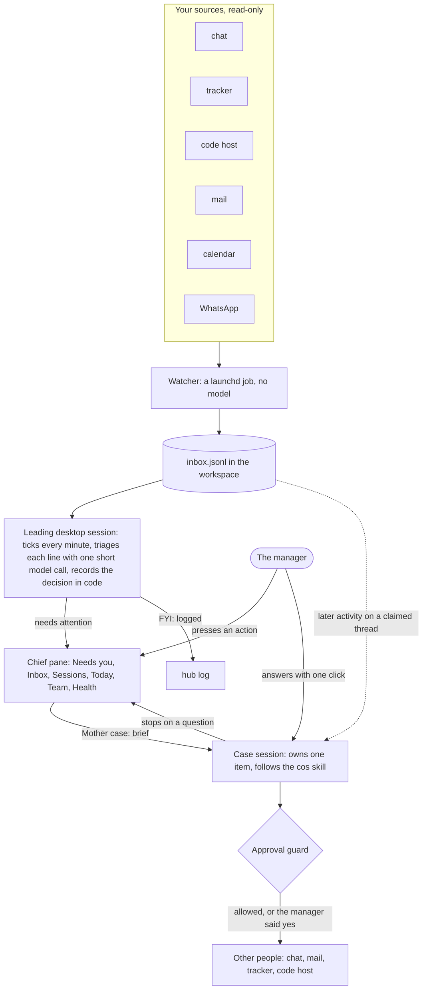
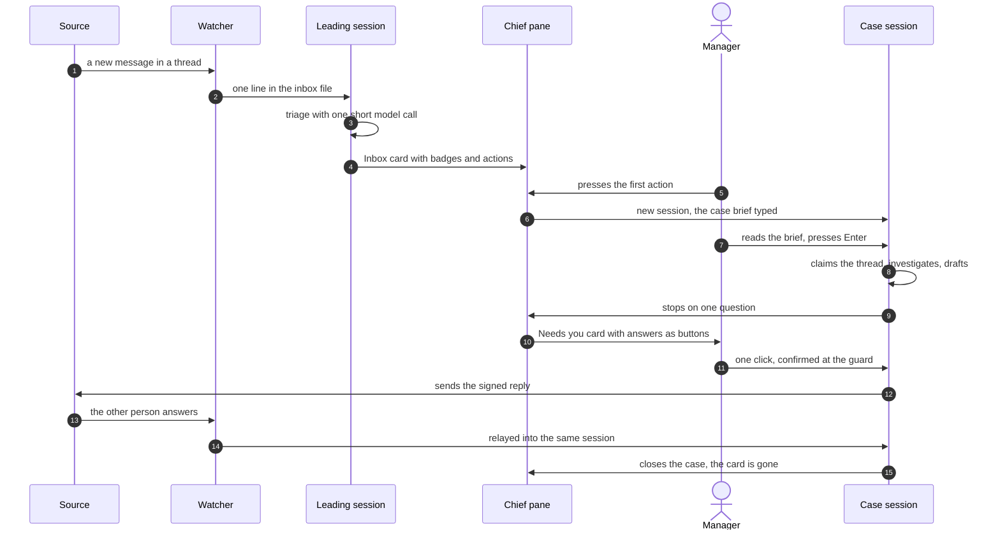
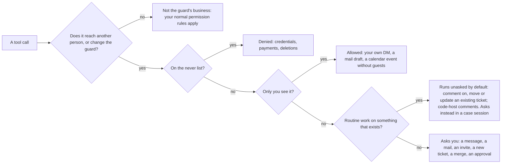

# MOTHER

**M**anager's **O**perations, **T**asks, **H**andoffs, **E**xecution & **R**eporting.

A chief of staff for people managers, built as a [Claude Code](https://claude.com/claude-code) plugin.
It reads your chat, tracker, code host, mail and calendar, shows you only what needs a decision, and does the
rest in sessions you can watch. Anything another person would see waits for your yes.


> **Status: pre-alpha, one pilot.** One manager's workspace has run on it since 2026-10-23; nobody else has
> yet. The Chief pane and the Now panel use Claude Code's hooks-module API, which is early access. Expect rough
> edges, and please report them.

> Yes, it's named after the ship's computer in *Alien*. Unlike that one, this Mother never treats the crew as
> expendable: it works for the manager, in the open, and anything another person sees carries its signature.

**Contents:** [A day with it](#a-day-with-it) · [The Chief pane](#the-chief-pane) · [How it works](#how-it-works) ·
[Install and first run](#install-and-first-run) · [Skills](#skills) · [Routines](#routines) · [Safety](#safety) ·
[Configuration](#configuration) · [FAQ](#faq) · [Development](#development)

## A day with it

Sam manages two teams. Sam's agent is called Agnes, and signs what it writes `✨ Agnes (AI) · on behalf of Sam`.

1. **08:45, the brief.** A message lands in Sam's own DM: today's calendar, the mail and chat that need an
   answer, the review queue, overdue open loops, and a numbered list Sam hands back with "go 1 3".
2. **09:00, the digest.** One post per team. Each opens with a short decision queue. Sam answers in the thread:
   "12 ticket, 13 drop, 14 mine".
3. **10:20, an Inbox card.** Dana asks in a team channel who owns a migration. A card appears in the Chief pane
   with `decide` and `urgent` badges and three buttons. Sam presses the first, **Propose an owner**. A new
   session opens with a brief already typed; Sam reads it and presses Enter.
4. **10:26, one question.** That session read the thread and the ticket, drafted a reply, and stopped. The
   pane's **Needs you** tab shows its question with three answers as buttons. Sam presses **Send it**, confirms
   the send, and the reply goes out, signed.
5. **14:00, a follow-up.** Dana answers in the thread. No new card appears: the reply is delivered into the
   session that owns the case. It reads the answer, marks the item done and reports the outcome in three lines.

At 21:30 a nightly pass turns the day into memory and sweeps the open loops, so tomorrow's brief knows what
today decided.

## The Chief pane

`/chief` opens a pane beside the chat (Claude Code desktop app). The images below are mocks with invented items.

| Inbox | Needs you |
|---|---|
|  |  |

- **Header.** A picture (the bundled portrait, or your own `<workspace>/.mother/portrait.png`), today's model
  spend against the daily budget, which session leads, the heartbeat's age, and a red pill while the guard is
  off or paused.
- **Tabs.** `Needs you`, `Inbox`, `Sessions`, `Today`, `Team`, `Health`, `All`. Each shows its count; Health
  shows a red dot when something is wrong. `/chief tab inbox` picks one from the prompt.
- **Cards.** Two rows when closed: the title with up to three action buttons, then badges (source; `decide`,
  `reply` or `act`; `urgent`; `case`), a human label, age and a link to the source. The first button is the
  recommended one. Click the title to expand: the full reason, what each button would send, Open session,
  Done, Follow, Ignore and Snooze. `/chief expand` and `/chief collapse` do it for every card.
- **Needs you.** Sessions that stopped on a question, with one button per answer. The message a button sends is
  shown beside it.
- **Sessions.** Your pinned desktop sessions and the case sessions, each with a two-line summary, a chat box and
  Open.
- **Today, Team.** Your Top 3 and what is on you; what each team is neglecting, by team. No per-person counts.
- **Health.** Each source, the watcher's last poll, routine reports that could not be delivered, budget and
  lead, and the guard's state.


Nothing in the pane sends anything to another person by itself. A button either fills a prompt for you to
submit, or sends a message into one of your own sessions, which the guard asks you to confirm.

## How it works

One background process, and it has no model: a watcher polls your sources into a local inbox file. The
thinking happens in Claude Code sessions you can see. (Two opt-in features still start a short headless run:
the team-channel reply loop, whose answers are written by a read-only session, and `mother eval`.)



- **The watcher** (`mother hub watch`, installed with `mother hub install`) is a plain Python process under
  launchd. It reads through a read-only allow-list and appends one line per changed thing to
  `<workspace>/.mother/hub/inbox.jsonl`. It never calls a model and never writes to a source.
- **One desktop session leads.** Every open desktop session runs the plugin's module; the first to tick leads,
  and another takes over when its heartbeat goes stale (120 s). Each minute the leader logs muted lines and
  asks a small model about the rest: is it work, does it need attention, what kind (`decide`, `reply`, `act`,
  `fyi`), who it is on, how urgent, and two or three actions. The decision itself is recorded by code
  (`mother chief triage`), never by the model.
- **Case sessions.** An action button opens a new session with a `Mother case:` brief. Its first prompt claims
  the thread, so later activity on it is delivered into that session as a `Mother relay:` message instead of a
  new card. The session follows the [`cos` skill](skills/cos/SKILL.md): investigate, do the next step, ask one
  question with a recommendation, close with an outcome.
- **Routines** (brief, digest, dots and the rest) are desktop scheduled tasks that run the same skills you can
  call by hand.
- **State is files.** Config, memory, todos, people, teams and the journal live in your private workspace and
  sync to your own git remote if you set one. Machine-local state lives under `.mother/` and never syncs.

### The life of one item



More detail, file by file: [ARCHITECTURE.md](ARCHITECTURE.md).

## Install and first run

**You need**

- **Claude Code.** The desktop app for the Chief pane, case sessions and scheduled routines (routines run only
  while the app is open; a missed run fires on the next launch). The terminal alone gets the skills, the guard
  and the CLI.
- **macOS** for the watcher (launchd), the spoken brief and WhatsApp. The skills, guard and CLI are plain Python.
- **Python 3.9+** and **git** on your PATH. `gh` if you want GitHub in the brief.
- **Connectors** for what you use: chat, mail, calendar, a tracker and a code host, all optional. MOTHER ships
  none. Setup finds the ones you have, and the doctor tests them.
- A **private** git repo for the workspace if you want backup or a second machine. Never a public one: the
  workspace holds your notes about people.

**1. Install the plugin and run setup.** In Claude Code:

```
/plugin marketplace add shayke-cohen/mother
/plugin install mother@mother
/mother:setup
```

Setup asks where to put the workspace, discovers your people, teams, channels and meetings from your
connectors, shows you a draft config, and writes nothing until you confirm. Then it runs the doctor, sets this
machine as the home machine, registers the routines as scheduled tasks, and runs `mother link` so the `mother`
command works in your own terminal. To do that last step by hand:

```
python3 ~/.claude/plugins/marketplaces/mother/bin/mother link
```

**2. Turn on the watcher (optional, home machine).** Add a `hub` block to `config.json` with `enabled: true` and
one connection per source ([the block and its options](docs/GUIDE.md#the-watcher)), then:

```
mother hub smoke      # reads each source twice in a throwaway copy; prints status and counts, never content
mother hub install    # runs the watcher under launchd
mother hub status     # is it keeping up
```

**3. Open the pane.** In a desktop session in your workspace, type `/chief`. Keep one desktop session open: it
leads, and the Inbox fills as lines arrive. Pin the sessions you want on the Sessions tab.

**Another computer, same workspace:** install the plugin, run `mother link`, then
`mother join <your-private-repo-url>` and `/mother:doctor`. Only the home machine runs routines and the watcher
(`mother home show`).

**Uninstall:** disable the `Mother:` tasks in the scheduled tasks list, `mother hub uninstall`, then
`/plugin uninstall mother@mother` and `rm ~/.local/bin/mother`. Your workspace folder is untouched.

The day-to-day operating detail (watch intervals, DMs, WhatsApp, disk access, team-channel replies, the Now
panel, every command) is in [docs/GUIDE.md](docs/GUIDE.md).

## Skills

Call one by asking in plain words, or as `/mother:<name>`.

| Skill | Ask for it like | What it does |
|---|---|---|
| `setup` | "set up mother", "add a team" | Creates or edits the workspace config from what it discovers; writes nothing until you confirm |
| `doctor` | "check my connectors" | Live-tests every connector with one real read each and records what works |
| `brief` | "brief me", "what did I miss" | One picture of the day: calendar, mail and chat needing action, review queue, overdue todos. Read-only |
| `digest` | "the standup", "what's blocked" | Per-team digest that opens with a decision queue you answer in one line |
| `dots` | "connect the dots" | Links across mail, chat, tracker, code and calendar; two short action lists |
| `commitments` | "what did I promise" | Promises you made, promises made to you, asks with no reply; offers nudge drafts |
| `one-on-one` | "prep my 1:1 with Sam" | Per-report prep, a shareable agenda kept apart from private notes, cadence drift |
| `meeting` | "prep the weekly" | Sprint plan page, meeting deck with meeting mode, results written back to the tracker, recap |
| `now` | "what's on me now" | The tick's current list; runs one suggested action when you ask |
| `cos` | starts from a `Mother case:` brief | The contract for a session that owns one item until it is closed |
| `todo` | "add a todo", "what's open" | Open loops: add, close, adopt, sweep |
| `remember` | "remember that …" | Writes one durable fact to memory |
| `project` | "start a project for X" | A container for work that spans sessions |
| `team` | "update the roadmap" | A team's files: people, roadmap, intake, sprints |
| `reflect` | "review today" | Nightly: distil the day into memory, expire stale todos, write the journal |
| `channels` | `/loop /mother:channels` | Replies in team channels by per-channel mode (`off`, `watch`, `mention`, `draft`, `auto`) |
| `whatsapp` | "what did Sam say on WhatsApp" | Reads chats from the local WhatsApp database; each send to someone else asks first |
| `hub` | `/mother:hub` | Decides the inbox from a terminal session when no desktop session leads |
| `routine` | (scheduled tasks only) | The dispatcher every scheduled run enters through |

Two read-only sub-agents back them: `reader` (one source, cited items) and `critic` (checks a draft before you
see it).

## Routines

Scheduled tasks in the desktop app, in your timezone. Defaults; change them in `config.json` → `routines`.

| Routine | When (default) | What you get |
|---|---|---|
| `brief` | 08:45 workdays | The day in one message to your own DM; a spoken version if you turn audio on |
| `digest` | 09:00 workdays | Per team, opening with the decision queue |
| `dots` | 13:00 workdays | Connections across threads, and suggested actions for you and for the agent |
| `commitments` | 16:30 workdays | What you promised, what you are waiting on, asks with no reply after 3 days |
| `one-on-one` | 07:30 workdays | Prep for each of today's 1:1s, and a note when a report's 1:1s have lapsed |
| `tick` | hourly, 06:00-22:00 workdays | The Now list: what is blocked on you, what teams are neglecting, your Top 3. Sends nothing unless you ask it to |
| `reflect` | 21:30 daily | Memory and open loops updated from the day |
| `doctor` | daily | Re-tests every connector, heals what it can, alerts once per broken one |
| `meeting-prep`, `meeting-recap` | around each team's weekly meeting | The deck, then a recap draft |
| `weekly-snapshot` | 16:00 workdays | After a sprint rolls over: a snapshot and a metrics row. Silent |
| `monthly-refresh` | 1st of the month, 10:00 | Refreshes per-repo notes, flags roadmap drift |
| `brief-ab` | off by default | A/B test of how the brief gathers its sources |

Routines report to your own DM. The few that act beyond it (a ticket you answered "ticket" to in the digest, an
agent action you approved in dots) do so through a bounded grant. `mother runs` shows which ones missed their
last slot.

## Safety

### The approval guard

`hooks/guard.py` is a hook that runs before tool calls and decides in code, not in the prompt. Once the plugin
is installed it runs in **every** Claude Code session, not only in the workspace.



The diagram is simplified. The guard also asks before unusual shell commands inside the workspace and before
edits to its own files, the config and the persona files, because those are how injected text would persist.
Full rules: [docs/CONTRACT.md §5](docs/CONTRACT.md#5-approval-guard-hooksguardpy).

| Level | Examples | Who decides |
|---|---|---|
| Free | Reading anything; drafts; workspace files; posts to your own DM | Nobody: it just happens |
| Routine work | Comment on, transition or update an existing ticket; code-host comments | Runs unasked under `policy.autonomy: "functional"` (the default), except in case sessions, where it asks. Set `"strict"` and it asks everywhere |
| Reaches a person | Chat post, mail send, invite with guests, new ticket, merge, approve, WhatsApp to someone else | You, each time, in the permission prompt |
| Never | Entering credentials, payments, permanent deletions (`gh … delete` included) | Refused. Do those yourself |

Switches:

- `mother guard off|on|status`. **Off means off:** no guard rule runs in any session, the model alone decides,
  and text it reads in a mail or a chat can steer it into sending. The pane shows a red `guard off` pill.
- `touch "$(mother path)/.mother/PAUSED"` blocks every outbound call until you delete the file. It wins over
  `guard off`. Routines still read and still write to the workspace.
- `mother chief pause` / `resume` stops only the leading session's tick and triage.
- `mother grant add …` gives an unattended run a bounded, signed grant; the guard asks you before each `add`.

A session that receives other people's words from the watcher (a case session, or the terminal hub session)
gets stricter rules: the routine-work shortcut is off there, so every outbound action asks. Use a fresh session
for anything unrelated.

Costs: the guard is a Python process on every tool call, about a tenth of a second each. Edits to
`~/.claude/settings.json`, `~/.claude.json` or anything under `~/.claude/plugins/` ask in every session, since
they could switch the guard off.

### What leaves the machine

MOTHER has no server and sends no telemetry. What goes where:

| What | Goes to | When |
|---|---|---|
| Whatever a session reads and writes | The model API, as in any Claude Code session | Whenever a session works |
| One inbox line (its key, title, up to 1000 characters of summary, who wrote it, link) plus the **names** of you, your teams and their people, and the tracker projects and repos you follow. No ids, no email addresses | The model API | Triage, once per line that needs judging |
| The recent tail of each pinned session (at most 6000 characters, tool output left out) | The model API | The Sessions tab's two-line summaries, only while the pane is shown |
| The last 3000 characters of a pinned or case session's final message | The model API | When its turn ends, to tell whether it stopped on a question |
| Your workspace files | Your own private git remote, if you set one | `mother sync`, at the end of each turn. A secret scan runs first and stops the commit on a hit |
| Connector reads | The connectors you configured | The watcher and the sessions |

The watcher itself calls no model. WhatsApp chats are read from the local database and copied nowhere. Model
calls made by the pane count against `chief.daily_budget_usd` (default $20); over budget none are made, and
lines show up untriaged.

### What it won't do

No performance assessments, scores, sentiment or mood reads of a person, and no per-person delivery metrics.
It reports work items. Tell your team the agent exists and what it reads.

## Configuration

Everything is in `<workspace>/config.json`; `mother status` validates it. Full schema:
[docs/CONTRACT.md §3](docs/CONTRACT.md#3-configjson-schema-v1). A filled example:
[templates/workspace/config.example.json](templates/workspace/config.example.json).

| Block | What it holds |
|---|---|
| `agent`, `manager` | The agent's name and signature; your timezone, workdays, quiet hours, own DM |
| `teams` | People, channels and their reply modes, tracker projects, repos, the weekly meeting |
| `routines` | Which routines run, and when |
| `policy` | `autonomy` (`functional` or `strict`) and other guard settings. Policy can only tighten the defaults |
| `hub` | The watcher: `enabled`, one connection per source, per-source intervals |
| `chief` | `daily_budget_usd`, `triage_model` and `tldr_model` (`sonnet` or `opus`) |
| `whatsapp` | Off unless you set it up with `mother whatsapp setup` |

Your own portrait for the pane: `<workspace>/.mother/portrait.png` (plus a small `portrait.jpg` for the desktop
app).

## FAQ

**Does it send messages as me?** It acts through your own accounts, so yes, and every message, comment or
ticket it writes is signed `✨ <agent> (AI) · on behalf of <you>`. Anything another person would see asks you
first, except routine tracker and code-host work under the default `functional` autonomy (see Safety).

**Which chat, tracker and mail does it work with?** Whatever your Claude Code connectors reach. Skills speak in
capabilities (`chat.read`, `tracker.create`); the doctor records which server provides each. The watcher's
adapters are narrower: today they cover Slack, Gmail, Jira, Google Calendar, GitHub (through `gh`) and the
local WhatsApp database ([docs/CONTRACT.md §5e](docs/CONTRACT.md#5e-hub-libhubpy-mother-hub)).

**Does it run when my laptop is closed?** No. The watcher and the scheduled tasks run on your home machine
while it is awake and the desktop app is open. A missed routine fires on the next launch.

**What does it cost?** Routines and case sessions are ordinary Claude Code sessions on your plan. The pane's
own model calls (triage, summaries, question detection) are capped by `chief.daily_budget_usd`.

**Can it work without the desktop app?** Partly. Skills, the guard, the CLI and sync work in the terminal. The
Chief pane's leading session, case sessions and scheduled routines need the desktop app. `/mother:hub` can
decide the inbox from a terminal session instead.

**Where is my data?** In your workspace folder, as Markdown and JSON you can read and edit. The plugin repo
holds code only.

**What happened to the chief session and the workers?** Until 0.18.0 a long-lived background session and
headless workers did the work and posted decisions to your DM. They were removed: work now happens only in
sessions you can see. Old config keys for that layer are accepted and ignored.

**Is it safe to try on a real team?** It is pre-alpha with one pilot. Start with channels on `off` or `watch`,
keep `policy.autonomy` on `strict` until you trust it, and read `.mother/guard.log` to see every decision.

## Development

```
claude plugin validate . && claude plugin test .     # manifests and the pane's module tests
python3 -m unittest tests.test_docs tests.test_packaging   # fast checks
python3 -m unittest discover tests                    # everything; several minutes
```

Start with [AGENTS.md](AGENTS.md) (rules, commands, checklists, release steps) and
[ARCHITECTURE.md](ARCHITECTURE.md) (code map and flows). Both are written for coding agents and humans alike;
[llms.txt](llms.txt) indexes the docs. The spec is [docs/CONTRACT.md](docs/CONTRACT.md), the reasoning
[docs/DESIGN.md](docs/DESIGN.md), the plan [docs/ROADMAP.md](docs/ROADMAP.md).

| Path | What |
|---|---|
| `bin/mother` | The CLI (Python 3.9 stdlib): workspace, sync, guard switch, routines, hub, chief, floor, now, health |
| `hooks/` | The approval guard (`guard.py`) and the hooks module that draws the Chief pane and the Now panel |
| `lib/` | Small engines behind the CLI: hub, chief, floor, now, health, channels, WhatsApp |
| `skills/`, `routines/`, `agents/`, `rules/` | Markdown the model follows |
| `assets/`, `templates/` | The meeting deck, the sprint plan page, the portrait; a new workspace's skeleton |
| `tests/` | stdlib `unittest`, plus `hooks/*.test.tsx` for the module |

## License

[MIT](LICENSE)
